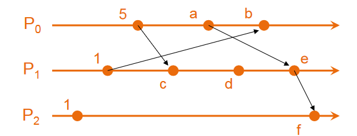
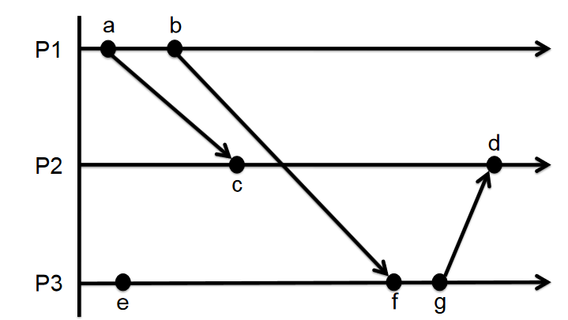

# Tugas-5-Cloud

**CAK3EAB3 Komputasi Awan dan Terdistribusi — Tugas 5: Koordinasi pada Sistem Terdistribusi**

Program Studi XXX · Fakultas Informatika · Universitas Telkom · Bandung · 2026
Kelompok: xxx · Kelas IF-XX-XX · Dosen: XXX

Dokumen asli (PDF): [`docs/Tugas-5_Koordinasi_pada_Sistem_Terdistribusi.pdf`](docs/Tugas-5_Koordinasi_pada_Sistem_Terdistribusi.pdf)

## Struktur Repository

```
.
├── README.md                     # Soal dan jawaban Tugas 5
├── requirements.txt              # Dependensi program (rns)
├── .vscode/                      # Konfigurasi Run/Debug VS Code
├── docs/
│   ├── Tugas-5_Koordinasi_pada_Sistem_Terdistribusi.pdf
│   └── images/                   # Diagram soal nomor 1
└── src/
    ├── soal1_logical_clock.py    # Soal 1: Lamport & vector clock
    ├── node_a_pengirim.py        # Soal 2d - Node A: mengirim pesan
    └── node_b_penerima.py        # Soal 2d - Node B: announce & menerima pesan
```

## Menjalankan di VS Code

**Persiapan (sekali saja):**

1. Install [Python 3.8+](https://www.python.org/downloads/) dan [VS Code](https://code.visualstudio.com/).
2. Clone repository ini, lalu buka foldernya di VS Code (**File → Open Folder...**).
3. Install extension yang direkomendasikan (**Python** dan **Python Debugger**). VS Code akan menawarkannya otomatis.
4. Buat virtual environment dan install dependensi: **Terminal → Run Task... → Setup: buat .venv dan install requirements**.
   Atau lewat terminal:
   ```bash
   python -m venv .venv
   # Windows:
   .venv\Scripts\pip install -r requirements.txt
   # macOS / Linux:
   .venv/bin/pip install -r requirements.txt
   ```
5. Pastikan interpreter yang dipakai adalah `.venv` (**Ctrl+Shift+P → Python: Select Interpreter**).

**Menjalankan program:** buka panel **Run and Debug** (Ctrl+Shift+D), pilih konfigurasi, lalu tekan **F5**.

| Konfigurasi | Keterangan |
|-------------|------------|
| `Soal 1: Logical Clock` | Menghitung dan menampilkan langkah Lamport timestamp, vector clock, dan hubungan event c–g |
| `Soal 2d: Node B + Node A` | Menjalankan Node B dan Node A sekaligus. Node A otomatis membaca hash Node B, lalu mengirim pesan |
| `Soal 2d: Node B (penerima)` | Hanya menjalankan Node B. Hentikan dengan tombol Stop atau Ctrl+C |
| `Soal 2d: Node A (pengirim)` | Mengirim pesan ke Node B yang sedang berjalan di komputer yang sama |
| `Soal 2d: Node A (masukkan hash manual)` | Mengirim ke Node B di komputer lain (satu LAN). Isi hash yang ditampilkan Node B |

Saat pertama kali dijalankan, Reticulum otomatis membuat file konfigurasi di `~/.reticulum/config`. Hash Node B disimpan di `data/node_b_hash.txt` dan identity-nya di `data/node_b_identity`, sehingga hash Node B tetap sama setiap kali dijalankan ulang.

## Ketentuan

1. Dikerjakan secara kelompok.
2. Dikerjakan langsung pada lembar soal.
3. Jawaban ditulis dengan tulisan tangan yang rapi.
4. Tulisan tangan harus terbaca dengan baik. Tulisan yang tidak terbaca diberi nilai 0.
5. Untuk soal perhitungan, maka cara atau langkah pengerjaan wajib dituliskan.
6. Setiap anggota kelompok wajib mengerjakan soal (ikut berkontribusi).
7. Anggota kelompok yang tidak ikut mengerjakan maka nilainya nol, nama mahasiswa tersebut tidak perlu ditulis di tabel.
8. Unggah jawaban ke LMS diwakili oleh salah satu anggota kelompok. Lembar fisik dikumpulkan pada saat pertemuan di kelas.
9. Lengkapi tabel pernyataan di bawah ini sebagai syarat nilai diinput.

### Pernyataan

Saya menyatakan bahwa saya:

- (a) benar-benar ikut mengerjakan soal
- (b) telah menjelaskan jawaban saya ke teman anggota kelompok
- (c) telah memahami penjelasan dari teman anggota kelompok
- (d) tidak mencontek jawaban dari kelompok lain
- (e) tidak memberikan jawaban PR ini ke kelompok lain

| Nama | NIM | Kontribusi Tugas | Tanda Tangan |
|------|-----|------------------|--------------|
|      |     |                  |              |
|      |     |                  |              |
|      |     |                  |              |

---

## 1. Logical Clock

### a. Tentukan Lamport timestamp pada diagram berikut ini



**Jawaban:**

Aturan Lamport: setiap event lokal/kirim, `LC = LC + 1`; saat menerima pesan dengan timestamp `t`, `LC = max(LC, t) + 1`.

- **P0:** event awal = 5 (kirim ke c); a = 5 + 1 = 6 (kirim ke e); b = terima dari event P1 (timestamp 1) → max(6, 1) + 1 = 7.
- **P1:** event awal = 1 (kirim ke b); c = terima dari P0 (timestamp 5) → max(1, 5) + 1 = 6; d = 6 + 1 = 7; e = terima dari a (timestamp 6) → max(7, 6) + 1 = 8 (kirim ke f).
- **P2:** event awal = 1; f = terima dari e (timestamp 8) → max(1, 8) + 1 = 9.

**Hasil:** a = 6, b = 7, c = 6, d = 7, e = 8, f = 9.

### b. Gunakan vector clock untuk menentukan timestamp semua event



**Jawaban:**

Aturan vector clock (urutan vektor `[P1, P2, P3]`, semua dimulai dari `[0,0,0]`):
(1) sebelum setiap event, proses menaikkan komponennya sendiri;
(2) saat mengirim, vektor ikut dikirim;
(3) saat menerima, `VC = max(VC lokal, VC pesan)` per komponen, lalu komponen sendiri dinaikkan 1.

- **P1:** a = [1,0,0] (kirim ke c); b = [2,0,0] (kirim ke f).
- **P2:** c = max([0,0,0],[1,0,0]) lalu P2+1 = [1,1,0]; d = max([1,1,0],[2,0,3]) lalu P2+1 = [2,2,3].
- **P3:** e = [0,0,1]; f = max([0,0,1],[2,0,0]) lalu P3+1 = [2,0,2]; g = [2,0,3] (kirim ke d).

| Event | a | b | c | d | e | f | g |
|-------|---|---|---|---|---|---|---|
| Vector clock | [1,0,0] | [2,0,0] | [1,1,0] | [2,2,3] | [0,0,1] | [2,0,2] | [2,0,3] |

### c. Menggunakan gambar b, tentukan apakah event c dan event g terjadi secara konkuren atau happens before jika menggunakan vector clock?

**Jawaban:**

Dari jawaban 1.b: VC(c) = [1,1,0] dan VC(g) = [2,0,3].

Syarat happens-before: c → g jika VC(c) ≤ VC(g) untuk semua komponen dan minimal satu komponen lebih kecil.

Bandingkan per komponen: P1: 1 < 2, P2: 1 > 0, P3: 0 < 3.

Karena komponen P2 pada c lebih besar (1 > 0) sementara komponen P1 dan P3 lebih kecil, maka VC(c) ≰ VC(g) dan VC(g) ≰ VC(c).

**Kesimpulan:** event c dan event g terjadi secara **KONKUREN (c ∥ g)**, tidak ada hubungan happens-before di antara keduanya. Hal ini juga terlihat dari diagram: tidak ada rantai pesan dari c ke g maupun dari g ke c (pesan dari g baru diterima P2 pada event d, setelah c).

---

## 2. Reticulum Announce

> Untuk 2.a, 2.b, 2.c: tunjukkan baris-baris pada source code reticulum untuk mendukung jawaban Anda.

### a. Jelaskan apa yang dimaksud dengan announce pada reticulum!

**Jawaban:**

Announce adalah paket khusus (tipe `ANNOUNCE`) yang dipancarkan oleh sebuah destinasi untuk memberitahukan keberadaannya ke jaringan. Karena Reticulum tidak memiliki alamat terpusat (coordination-less), announce menjadi satu-satunya cara node lain mengetahui bahwa suatu destinasi ada, dapat dijangkau, dan bagaimana mengenkripsi data untuknya.

Isi announce: public key identitas (X25519 untuk enkripsi + Ed25519 untuk tanda tangan), name hash, random hash (berisi timestamp), ratchet key (opsional), tanda tangan digital, dan `app_data` opsional. Dengan menerima announce, node lain memperoleh public key tujuan sekaligus membangun jalur (path) menuju destinasi tersebut.

Potongan source code pendukung (`RNS/Destination.py`):

```python
# docstring class Destination
# A destination can also announce its presence on the network, which will distribute
# necessary keys for encrypted communication with it.

def announce(self, app_data=None, path_response=False, attached_interface=None, tag=None, send=True):
    """Creates an announce packet for this destination and broadcasts it on all
    relevant interfaces. Application specific data can be added to the announce."""

announce_data = self.identity.get_public_key()+self.name_hash+random_hash+ratchet+signature
if app_data != None: announce_data += app_data
```

### b. Jelaskan cara kerja mekanisme announce pada reticulum!

**Jawaban:**

1. **Pembuatan:** aplikasi memanggil `destination.announce()`. Hanya destinasi bertipe `SINGLE` dengan arah `IN` yang boleh announce. Reticulum membuat `random_hash` (5 byte acak + 5 byte timestamp), lalu menandatangani gabungan hash destinasi + public key + name hash + random hash (+ ratchet + app_data) dengan kunci privat Ed25519.
2. **Pengiriman:** paket bertipe `ANNOUNCE` dikirim (broadcast) ke semua interface yang relevan.
3. **Validasi:** node penerima memeriksa tanda tangan dan mencocokkan hash destinasi dengan hash dari name_hash + identity hash. Announce yang tidak valid dibuang; announce duplikat dikenali lewat `random_hash`.
4. **Propagasi:** Transport Node menyimpan announce di announce table, menaikkan hop count, lalu me-rebroadcast setelah jeda acak (`PATHFINDER_RW`) dengan sejumlah retry (`PATHFINDER_R`). Announce tidak diteruskan lagi jika sudah melewati batas `PATHFINDER_M = 128` hop. Penggunaan bandwidth untuk announce dibatasi (announce cap, default 2% per interface) agar jaringan tidak banjir.
5. **Penerimaan di aplikasi:** node lain menyimpan public key (`Identity.remember`) dan path ke destinasi, serta memanggil announce handler yang didaftarkan lewat `RNS.Transport.register_announce_handler()`.

Potongan source code pendukung (`RNS/Destination.py`, method `announce`):

```python
if self.type != Destination.SINGLE:
    raise TypeError("Only SINGLE destination types can be announced")

random_hash = RNS.Identity.get_random_hash()[0:5]+int(time.time()).to_bytes(5, "big")

signed_data = self.hash+self.identity.get_public_key()+self.name_hash+random_hash+ratchet
if app_data != None: signed_data += app_data
signature = self.identity.sign(signed_data)

announce_packet = RNS.Packet(self, announce_data, RNS.Packet.ANNOUNCE, context = announce_context,
    attached_interface = attached_interface, context_flag=context_flag)
if send: announce_packet.send()
```

`RNS/Transport.py` (konstanta dan pemrosesan announce):

```python
PATHFINDER_M  = 128   # Max hops
PATHFINDER_R  = 1     # Retransmit retries
PATHFINDER_RW = 0.5   # Random window for announce rebroadcast

if packet.packet_type == RNS.Packet.ANNOUNCE:
    if RNS.Identity.validate_announce(packet): ...
        Transport.announce_table[packet.destination_hash] = [now, retransmit_timeout, retries,
            received_from, announce_hops, packet, local_rebroadcasts, block_rebroadcasts, attached_interface]
```

### c. Bagaimana routing dibuat pada reticulum?

**Jawaban:**

Reticulum tidak memakai alamat IP atau tabel routing yang dikonfigurasi manual. Routing dibentuk otomatis dari announce: setiap Transport Node yang menerima announce valid mencatat entri path table berisi hash tujuan, next hop (node yang meneruskan announce, `received_from`), jumlah hop, waktu kedaluwarsa, dan interface penerima. Bila satu tujuan diterima lewat beberapa jalur, jalur dengan hop paling sedikit (atau yang lebih baru bila jalur lama kedaluwarsa) yang disimpan.

Saat mengirim paket ke tujuan yang hop-nya > 1, Transport menyisipkan header tipe `HEADER_2` berisi `transport_id` = hash next hop, sehingga setiap node hanya perlu tahu "lompatan berikutnya" (hop-by-hop routing), bukan rute lengkap. Jika path belum diketahui, node mengirim path request ke destinasi khusus `rnstransport.path.request`, dan node yang tahu jalurnya (atau tujuan itu sendiri) membalas dengan announce bertipe `PATH_RESPONSE`. Path kedaluwarsa setelah `PATHFINDER_E` (default 1 minggu) dan diperbarui oleh announce baru.

Potongan source code pendukung (`RNS/Transport.py`):

```python
PATHFINDER_E = 60*60*24*7   # Path expiration of one week

# di Transport.inbound(), setelah announce tervalidasi:
Transport.path_table[packet.destination_hash] = [now, received_from,
    announce_hops, expires, random_blobs, packet.receiving_interface, packet.packet_hash]

# di Transport.outbound(), saat mengirim ke tujuan multi-hop:
if Transport.path_table[packet.destination_hash][IDX_PT_HOPS] > 1:
    new_flags = (RNS.Packet.HEADER_2) << 6 | (Transport.TRANSPORT) << 4 | (packet.flags & 0b00001111)
    new_raw = struct.pack("!B", new_flags) + packet.raw[1:2] \
        + Transport.path_table[packet.destination_hash][IDX_PT_NEXT_HOP] + packet.raw[2:]

# Permintaan jalur jika path belum diketahui:
def request_path(destination_hash, on_interface=None, tag=None, recursive=False):
    path_request_dst = RNS.Destination(None, RNS.Destination.OUT, RNS.Destination.PLAIN,
        Transport.APP_NAME, "path", "request")
```

> Catatan: nama tabel/indeks dapat sedikit berbeda antarversi RNS (versi lama memakai nama `destination_table`); cocokkan dengan versi source code yang Anda gunakan.

### d. Buatlah program menggunakan reticulum untuk mengirim pesan dari node A. Lampirkan source code program dan screenshot hasilnya.

**Jawaban:**

Program terdiri dari dua bagian:

- [`src/node_b_penerima.py`](src/node_b_penerima.py) — destinasi `IN` yang melakukan announce dan menampilkan pesan masuk.
- [`src/node_a_pengirim.py`](src/node_a_pengirim.py) — Node A yang mencari path ke Node B lalu mengirim pesan.

Jalankan Node B terlebih dahulu, salin hash tujuan yang tampil, lalu jalankan Node A dengan hash tersebut. Kedua node dapat dijalankan pada dua komputer dalam satu LAN (AutoInterface aktif secara default di `~/.reticulum/config`) atau pada satu komputer.

**Cara menjalankan:** di VS Code, pilih konfigurasi `Soal 2d: Node B + Node A` lalu tekan F5 (lihat [Menjalankan di VS Code](#menjalankan-di-vs-code)). Bisa juga lewat dua terminal:

```bash
pip install -r requirements.txt     # atau: pip install rns
python src/node_b_penerima.py                                          # terminal 1
python src/node_a_pengirim.py                                          # terminal 2, hash dibaca otomatis
python src/node_a_pengirim.py <hash_tujuan_node_B> "Halo dari Node A!" # atau hash manual
```

Untuk soal 1, perhitungannya bisa dicek dengan `python src/soal1_logical_clock.py`.

**Hasil eksekusi program (simulasi tampilan terminal):**

Terminal 1 — Node B (penerima):

```
user@node-b:~/tugas5$ python node_b_penerima.py
[2026-10-19 10:15:02] [Notice] Node B siap, hash tujuan: <a3f91c0e7b2d4568e1f0c9a7b3d25e14>
[2026-10-19 10:15:02] [Notice] Announce dikirim
[2026-10-19 10:15:20] [Notice] Pesan diterima: Halo dari Node A!
[2026-10-19 10:15:32] [Notice] Announce dikirim
^C
```

Terminal 2 — Node A (pengirim):

```
user@node-a:~/tugas5$ python node_a_pengirim.py \
    a3f91c0e7b2d4568e1f0c9a7b3d25e14 "Halo dari Node A!"
[2026-10-19 10:15:19] [Notice] Path belum ada, mengirim path request...
[2026-10-19 10:15:20] [Notice] Pesan dikirim ke <a3f91c0e7b2d4568e1f0c9a7b3d25e14>
[2026-10-19 10:15:20] [Notice] Pesan terkonfirmasi diterima Node B (RTT 0.042 s)
user@node-a:~/tugas5$
```
